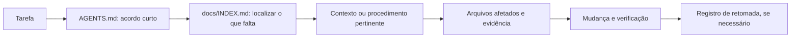

# GraviCodex Template

Base de engenharia em Markdown para trabalhar com **Codex e Antigravity**, com contexto sob demanda. A proposta é reduzir releituras, duplicação e recuperação de informação irrelevante, mantendo evidência suficiente para concluir cada tarefa.

## Começar

1. Use este repositório como base de um projeto.
2. Abra a raiz no agente. [AGENTS.md](AGENTS.md) contém o acordo compartilhado.
3. Para adaptar a um produto, siga [a configuração inicial](docs/playbooks/bootstrap.md). Para melhorar o próprio template, trabalhe diretamente na rota pertinente do [índice](docs/INDEX.md).
4. Valide com Python 3.11 ou superior:

```sh
python3 scripts/check_docs.py
git diff --check
```

Não há stack de aplicação, serviço externo ou pacote de IA obrigatório. Os comandos acima validam esta base documental; não substituem testes do produto que vier a ser criado.

## Como o contexto circula



Links comuns apontam caminhos; não importam automaticamente seu conteúdo. O grafo representa a estratégia de trabalho, não uma automação de carregamento.

## O que vem pronto

| Recurso | Utilidade |
| --- | --- |
| [Índice de rotas](docs/INDEX.md) | Escolher o documento pela tarefa |
| [Mapa de dependências](docs/context/map.md) | Identificar impacto sem varrer a base |
| [Guia de eficiência](docs/guides/efficiency.md) | Buscar, resumir e medir sem perder contexto essencial |
| [Compatibilidade dos agentes](docs/guides/agents.md) | Entender descoberta automática e diferenças de escopo |
| [Modelos](docs/templates/task.md) | Registrar tarefa, decisão e contrato quando necessários |
| [Fontes consultadas](docs/research/sources.md) | Separar comportamento documentado de escolhas deste template |

## Limites da proposta

Tamanho em bytes é um indicador de manutenção, não uma contagem de tokens. A checagem mostra tamanhos e protege limites locais; não mede a conversa nem prova economia. Compare tarefas equivalentes com dados do agente antes de anunciar ganhos.

Para contribuir, veja [CONTRIBUTING.md](CONTRIBUTING.md).
