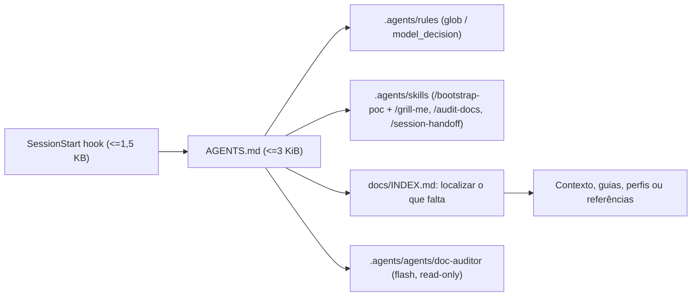

# GraviCodex Template

Base de engenharia **Antigravity-first** em Markdown + Python stdlib, focada no **Google Antigravity** (App/Desktop 2.0, CLI `agy` e Antigravity IDE), mantendo o **Codex em *stand-by*** via `AGENTS.md`. A proposta combina contexto sob demanda, customizações nativas enxutas em `.agents/` e criação de projetos guiada por entrevista estilo **`/grill-me`** para esculpir os Markdowns sob medida antes de codar — com zero dependências externas obrigatórias.

## Começar um novo projeto (fluxo grill-me)

1. Use este repositório como base de um novo projeto ou POC e abra a raiz no Google Antigravity.
2. O hook `SessionStart` ([.agents/hooks.json](.agents/hooks.json)) injeta automaticamente um snapshot compacto (`Modo: TEMPLATE`, desligável em 1 linha com `"enabled": false`).
3. Envie sua ideia resumida usando `/grill-me` com `/bootstrap-poc` (ou empilhe `/plan /grill-me`):

```text
/grill-me /bootstrap-poc Quero criar uma POC de <seu problema/ideia em 2 linhas>
```

4. O agente escolhe 1 perfil de reconhecimento em [docs/starters/](docs/starters/README.md) (no máximo 2 em projetos híbridos), entrevista você **uma decisão por vez com opção recomendada**, confirma o resumo das escolhas e esculpe os Markdowns sob medida do projeto (`AGENTS.md`, `docs/context/{project,map,commands}.md`, `.agents/rules/`, `docs/INDEX.md`, ADRs e `docs/references/` se acadêmico) antes de implementar o menor fluxo funcional e executar a faxina pós-reconhecimento ([playbook](docs/playbooks/bootstrap.md)).
5. Valide localmente com Python 3.11+:

```sh
python3 scripts/check_docs.py && python3 -m unittest discover -s tests -v && git diff --check
```

Não há stack de aplicação, plugin externo ou pacote de IA obrigatório. Os comandos acima validam esta base documental e suas customizações nativas; não substituem testes do produto que vier a ser criado.

## Arquitetura de contexto no Antigravity



Links Markdown comuns apontam caminhos sem importar seu conteúdo automaticamente. O carregamento seletivo combina recursos nativos do Antigravity (`.agents/`) com navegação explícita pelo índice.

## O que vem pronto

| Recurso | Utilidade |
| --- | --- |
| [Bootstrap via `/grill-me`](docs/playbooks/bootstrap.md) | Entrevista 1 decisão por vez para gerar Markdowns sob medida + faxina automática |
| [Perfis de POC descartáveis](docs/starters/README.md) | 10 perfis ricos que alimentam a entrevista e são removidos na faxina |
| [Índice de rotas](docs/INDEX.md) | Escolher o documento certo pela informação que falta |
| [Guia do Antigravity](docs/guides/antigravity.md) | Hierarquia nativa (`.agents/`), comandos `/`, plugins opcionais e Codex em stand-by |
| [Referências acadêmicas](docs/guides/references.md) | Bibliografia em 3 camadas anti-alucinação (ABNT, IEEE, APA 7) |
| [Mapa de dependências](docs/context/map.md) | Fronteiras reais da base e análise de impacto |
| [Guia de eficiência](docs/guides/efficiency.md) | Busca paralela, higiene de comandos e medição via `bench_transcript.py` |
| [Fontes e limites](docs/research/sources.md) | Separação entre documentação oficial, referências e escolhas locais |

## Limites da proposta

Bytes e palavras são indicadores locais de manutenção, não contagem de tokens. O validador protege links, limites e contratos `.agents/`; para medir impacto real em sessões do Antigravity, compare logs equivalentes com [bench_transcript.py](scripts/bench_transcript.py) antes de afirmar ganhos.

Para contribuir, veja [CONTRIBUTING.md](CONTRIBUTING.md).
