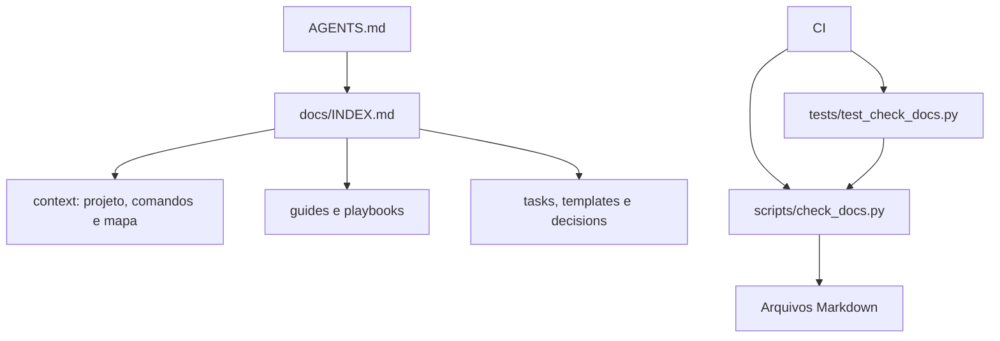

# Mapa do repositório

Este mapa cobre a base documental, não uma aplicação imaginada. A tabela possui os vínculos concretos; o diagrama é sua visão resumida. Atualize ambos quando mudar uma fronteira.

| Nó | Responsabilidade | Dependência ou consumidor |
| --- | --- | --- |
| [AGENTS.md](../../AGENTS.md) | Acordo comum e entrada | Agentes; encaminha ao índice |
| [Índice](../INDEX.md) | Rotear dúvidas | Contexto, guias, procedimentos e registros |
| [Projeto](project.md) / [comandos](commands.md) | Descrever estado e execução | Tarefas e validação |
| [Procedimento de mudança](../playbooks/change.md) | Executar e verificar | Arquivos afetados e contratos |
| [Tarefas](../tasks/README.md) / [decisões](../decisions/0001-context-on-demand.md) | Guardar estado e motivos | Próxima sessão ou próxima mudança |
| [Validador](../../scripts/check_docs.py) | Conferir integridade documental | Markdown, links e limites |
| [Testes](../../tests/test_check_docs.py) | Verificar o validador | Script |
| [CI](../../.github/workflows/docs.yml) | Rodar as verificações | Script e testes |

Setas significam consulta ou dependência de verificação, conforme o nó. Não representam execução automática de Markdown.

## Analisar impacto

Siga o vínculo do nó alterado e confira seus consumidores diretos. Para uma simples correção textual, isso normalmente termina no documento e em seus links. Para um novo caminho, confira também índice, mapa e links de entrada.

Quando houver produto, adicione somente componentes reais. Use [o contrato de componente](../templates/component.md) para fronteiras que precisem de explicação; confira dependências no código antes de desenhar setas.
