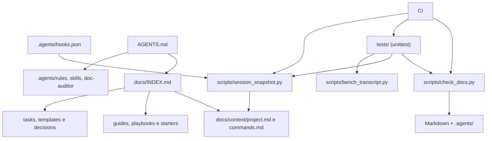

# Mapa do repositório

Este mapa cobre a base documental e as customizações nativas do Antigravity neste template. A tabela lista os vínculos concretos; o diagrama resume a estrutura. Atualize ambos quando mudar uma fronteira.

| Nó | Responsabilidade | Dependência ou consumidor |
| --- | --- | --- |
| [AGENTS.md](../../AGENTS.md) | Entrada sempre ativa, hábitos e gatilho `/bootstrap-poc` | Google Antigravity (e Codex stand-by); aponta ao índice |
| [.agents/hooks.json](../../.agents/hooks.json) | Configura hook `SessionStart` (`enabled: true`) | Invoca [session_snapshot.py](../../scripts/session_snapshot.py) |
| `.agents/rules/*.md` | Regras `glob` (`markdown-docs`, `academic-references`) e `model_decision` (`verification`) | Carregamento nativo sob demanda; validado por `check_docs.py` |
| `.agents/skills/*/SKILL.md` | Skills `/bootstrap-poc`, `/audit-docs`, `/session-handoff` | Invocação autônoma ou slash command |
| [.agents/agents/doc-auditor.md](../../.agents/agents/doc-auditor.md) | Subagente somente leitura (`model: flash`) | Delegado para auditorias sem poluir contexto |
| [.geminiignore](../../.geminiignore) | Filtro FinOps de dependências, builds e binários | Superfícies compatíveis do Antigravity |
| [Índice](../INDEX.md) | Rotear consultas sob demanda | Contexto, guias, playbooks, starters e decisões |
| [Contexto](project.md) / [comandos](commands.md) | Estado (`TEMPLATE`/`PRODUTO`) e execução real | `session_snapshot.py`, tarefas e validação |
| [Perfis descartáveis](../starters/README.md) | 10 perfis de reconhecimento para POCs | Consumidos por `/bootstrap-poc`; deletados na Fase 4 |
| [Referências](../guides/references.md) | Esquema bibliográfico em 3 camadas + modelos | Projetos acadêmicos; removido nos demais na faxina |
| [Scripts](../../scripts/check_docs.py) | `check_docs.py`, `session_snapshot.py`, `bench_transcript.py` | CI, hooks, skills e medição offline |
| [Testes](../../tests/test_check_docs.py) / [CI](../../.github/workflows/docs.yml) | Regressão de scripts e integridade contínua | Validador, hook e analisador de transcripts |

Setas representam consulta, invocação ou verificação conforme o nó.

## Analisar impacto

Ao alterar um caminho em `docs/` ou `.agents/`, confira consumidores diretos em `AGENTS.md`, `docs/INDEX.md`, `docs/playbooks/bootstrap.md` (matriz de faxina) e rode `python3 scripts/check_docs.py`. Quando houver produto, substitua esta tabela pelos componentes reais do sistema e use [o contrato de componente](../templates/component.md) apenas onde a fronteira exigir detalhe.
